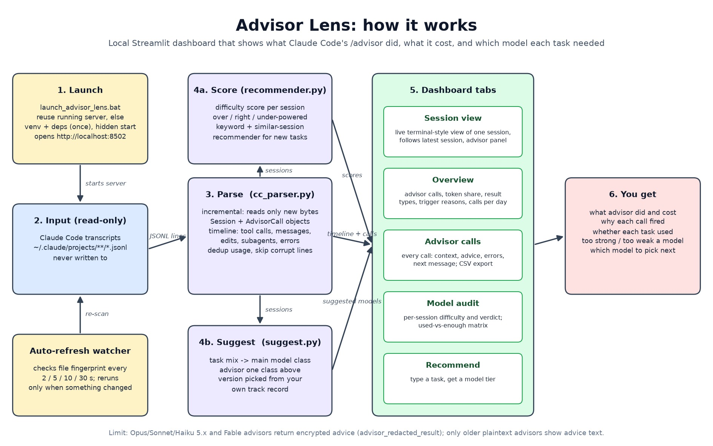

# Advisor Lens

A local Streamlit dashboard for Claude Code's `/advisor` tool and per-task model choice.

## Run (Windows)
Double-click `launch_advisor_lens.bat` (or the "Advisor Lens" desktop shortcut). The first run creates the venv in `%LOCALAPPDATA%\advisor-lens-venv` and installs the dependencies once. After that it opens http://localhost:8502.

The venv is kept per machine in `%LOCALAPPDATA%dvisor-lens-venv`, outside the project folder, so the project can sit in a synced folder.

It reads `C:\Users\<you>\.claude\projects\**\*.jsonl` (change it in the sidebar). Read-only: it never writes to the transcripts.

## Tabs
| Tab | Shows |
|---|---|
| Overview | Number of advisor calls, advisor token share, result types, heuristic trigger reasons, calls per day |
| Advisor calls | Every call: context before the call, the advice (plaintext advisors only), errors, the executor's next message. Exports to CSV. |
| Model audit | Per-session difficulty score, the tier that should have been enough, and a verdict (over-powered / right-sized / under-powered) |
| Recommend | Type a task and get a model tier, using keyword risk plus the most similar past sessions |

## Hard limit
Opus 5.x, Sonnet 5.5, Haiku 5.5 and Fable/Mythos advisors return `advisor_redacted_result`. That content is encrypted, and only the executor can read it server-side. The app can't decrypt it, and nothing client-side can. The advice text shows only for older plaintext advisors (`advisor_result`).

## First-run check (proxy chain)
Requests go through Headroom → pxpipe. Searching for the bare strings `server_tool_use` or `iterations` tells you nothing: every assistant line has `usage.server_tool_use` (web search counters) and `usage.iterations`, whether or not the advisor ran.
Two things reliably show an advisor call:
1. a **content block** `{"type": "server_tool_use", "name": "advisor"}` in `message.content`
2. an entry with `"type": "advisor_message"` in `usage.iterations`

If you know the advisor fired but neither shows up, a proxy is rewriting responses. Run one session with `ANTHROPIC_BASE_URL` unset and compare. (Checked 2026-11-25: both were present, so the proxies leave them intact.)

## Tuning
`recommender.py`: `WEIGHTS`, `THRESHOLDS`, `HARD_TERMS`, `EASY_TERMS`. The score is a heuristic. Calibrate it against 20–30 of your own sessions before you trust its verdicts.

## Files
- `cc_parser.py`: JSONL → Session / AdvisorCall (deduplicates usage per message id, tolerates corrupt lines)
- `recommender.py`: retrospective score and pre-task recommender
- `app.py`: the UI. The first tab, **Session view**, is a terminal-style live dashboard for one session (it refreshes every 5 s)
- `tabs_ui.py`: terminal-style views for Overview, Advisor calls (ledger and inspector), Model audit (used-vs-enough matrix) and Recommend (tier ladder)
- `run_hidden.vbs`: starts the server with no console window. The launcher waits for `/_stcore/health`, opens the browser, then exits. The log is at `%LOCALAPPDATA%\advisor-lens-venv\advisor-lens.log`.
- `terminal_ui.py`: renders the Session view as HTML. All transcript text is escaped.
- `.streamlit/config.toml`: dark theme, Deploy button hidden
- `docs/make_flow_chart.py`: redraws `docs/advisor-lens-flow.jpg` (`python docs/make_flow_chart.py docs/advisor-lens-flow.jpg`, needs matplotlib)
- `make_fixtures.py`: synthetic transcripts for testing (`python make_fixtures.py fx` → point the sidebar at `fx`)

## License

MIT. See [LICENSE](LICENSE).
